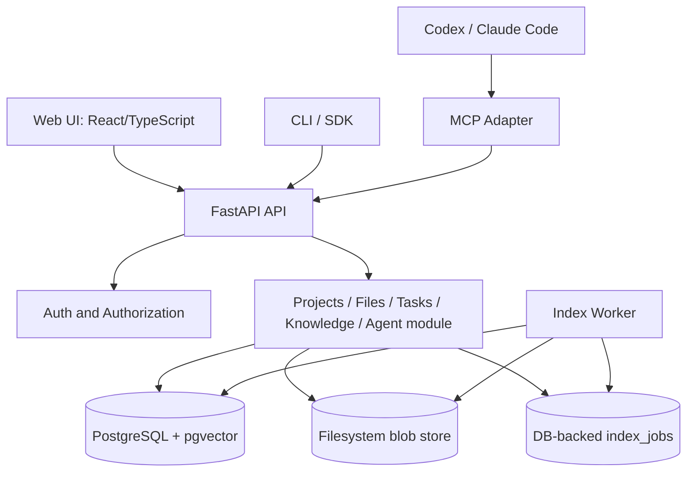

# GICHUKRO — Architecture v0.1

## 1. 목표와 비목표

### 목표
1. 프로젝트별 파일·문서 업로드/조회/버전 보존.
2. 프로젝트별 이슈·태스크·로드맵 관리.
3. 파일과 작업 기록을 키워드·벡터 하이브리드 검색으로 조회하고 출처 표시.
4. MCP를 통한 AI 컨텍스트 검색, 태스크 조회, 작업결과 초안 제출.
5. AI 작업 종료 시 핸드오프 작성, 새 AI가 업무 상태를 이어받기.
6. 개인 설치 환경에서 Docker Compose로 재현 가능하고 기본 보안·백업 제공.

### 비목표 (v0.1)
- Git 서버 프로토콜 직접 구현, GitHub 대체.
- 실시간 공동 편집, 비디오/오디오 전사, 멀티모달 임베딩.
- AI가 자동으로 승인 없이 코드 실행·머지·게시·지식 확정.
- 조직 전체 SSO/SCIM, 세밀한 기업용 정책 엔진.
- BIO 종속, 자동 에이전트 스케줄러, 완전 자율 오케스트레이션.

## 3. 시스템 경계와 컴포넌트



**배포단위:** `web`, `api`, `worker`, `postgres`, 선택적 `reverse-proxy`. MCP stdio bridge는 로컬 도구, 원격 MCP는 후속 단계.

**서비스 설계:** 초기에는 모듈형 모놀리스. 파일 메타데이터와 태스크 트랜잭션을 같은 DB에서 다루되, blob 쓰기·색인 워커는 outbox/job 상태로 최종 일관성 처리.

### 기술 스택
- Backend: Python 3.12+, FastAPI, Pydantic, SQLAlchemy 2.x, Alembic.
- Frontend: React, TypeScript, Vite, React Router, TanStack Query.
- Database: PostgreSQL + pgvector; Full Text Search (한글 품질은 별도 평가), trigram 옵션.
- Storage: local volume blob adapter (SHA-256 content-addressing); 향후 S3 compatible adapter.
- Worker: Python 별도 프로세스, DB job poll + `FOR UPDATE SKIP LOCKED` 기반 claim.
- Embeddings: provider interface (`local` / `remote`), 모델명/차원/버전 고정 및 기록. 기본 제공 모델 선정은 품질 테스트 후 확정.
- MCP: 초기 local stdio server가 기존 API를 호출하는 구조; credential은 환경변수/OS secret으로 주입.

## 4. 모듈 경계

| 모듈 | 책임 | 소유 데이터 |
|---|---|---|
| identity | 사용자 로그인, 세션, 서비스 토큰 | users, sessions, api_tokens |
| projects | 프로젝트 및 멤버 권한 | projects, project_members |
| files | 논리 파일, 불변 버전, blob | files, file_versions, blobs |
| work | 태스크, 이벤트, 연결 링크 | tasks, task_events, entity_links |
| knowledge | 추출물, 청크, 임베딩, 검색 | documents, chunks, index_jobs |
| agents | AI run, handoff, 검증상태 | agent_runs, handoffs |
| audit | 보안 이벤트 및 변경 추적 | audit_events |

모듈 간 직접 ORM 내부 객체 의존을 최소화하고 애플리케이션 서비스 인터페이스로 연계한다. 모든 리소스는 `project_id`를 명시적으로 보유하거나 권한 대상까지 FK로 연결한다.

## 5. 데이터 모델 (최소 스키마)

### 공통
- ID: UUID; timestamps: UTC `created_at`, `updated_at`; soft-delete 여부는 엔티티별로 명시.
- Project: `id`, `slug`, `name`, `description`, `visibility` (`PRIVATE`, `PUBLIC`), `owner_id`, `created_at`.
- ProjectMember: `project_id`, `user_id`, `role` (`OWNER`, `EDITOR`, `VIEWER`), UNIQUE(project_id,user_id).
- User: `id`, `email` unique, `password_hash`, `is_active`.
- ApiToken: `id`, `user_id`, `project_id`, `scopes[]`, `token_hash`, `expires_at`, `revoked_at`, `last_used_at`.

### 파일/버전
- File: `id`, `project_id`, `path`, `current_version_id`, `deleted_at`; UNIQUE(project_id,path) where active; 경로는 canonical POSIX relative path.
- Blob: `sha256`, `storage_key`, `size_bytes`, `media_type`, `scan_status`, `created_at`.
- FileVersion: `id`, `file_id`, `version_no`, `blob_sha256`, `size_bytes`, `created_by`, `created_at`; UNIQUE(file_id,version_no); immutable.
- `current_version_id`는 해당 file의 version을 참조하는지 애플리케이션 트랜잭션에서 검증(가능하면 DB trigger/복합 FK).

### 작업/지식
- Task: `id`, `project_id`, `title`, `description`, `status`, `priority`, `assignee_id`, `due_at`, `created_by`, timestamps.
- TaskEvent: `id`, `task_id`, `actor_type`, `actor_id`, `event_type`, `payload_json`, `created_at`.
- EntityLink: `project_id`, `source_type`, `source_id`, `target_type`, `target_id`, `created_at`; 양쪽 대상 프로젝트 일치 검증.
- Document: `id`, `project_id`, `file_version_id`, `extractor_version`, `text_sha256`, `parse_status`, `created_at`.
- Chunk: `id`, `project_id`, `document_id`, `ordinal`, `text`, `start_line`, `end_line`, `token_count`, `embedding_model`, `embedding_version`, `embedding vector(N)`.
- IndexJob: `id`, `project_id`, `file_version_id`, `job_type`, `status`, `attempt_count`, `lease_until`, `error_code`, timestamps; idempotency UNIQUE(file_version_id,job_type,embedding_version).

### 에이전트
- AgentRun: `id`, `project_id`, `task_id`, `agent_name`, `client_name`, `started_at`, `finished_at`, `status`.
- Handoff: `id`, `project_id`, `task_id`, `agent_run_id`, `summary`, `changes_json`, `tests_json`, `blockers_json`, `next_steps_json`, `evidence_json`, `verification_status` (`UNVERIFIED`, `APPROVED`, `REJECTED`), `approved_by`, timestamps.
- AuditEvent: `id`, `project_id nullable`, `actor_type`, `actor_id`, `action`, `target_type`, `target_id`, `metadata_json`, `created_at`.

**중요:** API 검색은 UI의 공개/비공개 표시와 독립적으로 서버에서 ACL을 강제한다. 검색의 필터는 chunk.project_id와 authorized project 목록으로 제한하며, SQL 레벨 권한 조건을 벡터 유사도 정렬과 함께 적용. DB RLS는 v0.2 강화 기능으로 고려할 수 있으나 v0.1에서도 서버 측 테스트로 누출 차단이 필수.

## 6. 파일 저장/버전 처리

1. 클라이언트는 `POST /projects/{id}/files` multipart upload.
2. 서버가 역할·크기·확장자·실제 MIME·경로를 검사하고 제한된 임시 경로에 stream 저장하며 SHA-256 계산.
3. Blob은 파일명 대신 해시 key로 웹 루트 밖에 저장; 중복 blob 재사용.
4. DB transaction: File/FileVersion 생성 + `current_version_id` 갱신 + IndexJob 삽입.
5. 비동기 워커가 허용된 텍스트/Markdown/PDF만 추출·청킹·임베딩.
6. 스캔/색인 실패는 파일 메타데이터에 명시하고 복구/재시도 가능; 이전 버전은 변경하지 않음.
7. 롤백은 이전 버전을 새로운 current version으로 선택하는 이벤트로 처리. 버전 자체는 불변.

MVP 기본 제한(운영자가 환경변수로 변경 가능): 파일당 25 MiB, 프로젝트당 1 GiB, API 동시 업로드 3, 추출 본문 최대 5 MiB. 이미지 파일은 저장/다운로드 가능하나 의미색인 대상 제외. ZIP은 내용 자동 추출·실행 금지. PDF 파싱은 워커 격리 후 활성화.

## 7. 지식 처리와 RAG

### 파이프라인
`uploaded -> validated -> extraction_queued -> extracted -> chunked -> embedded -> searchable`, 실패 시 `index_failed`.

- 지원 첫 단계: `.md`, `.txt`, `.py`, `.ts`, `.js`, `.json`, `.yaml`, `.yml`; PDF는 안전한 추출 워커 준비 이후 추가.
- Chunk: heading/문단/코드 블록 경계 우선, 초깃값 목표 400~800 tokens, overlap 80~120 tokens. 실제 성능으로 조정.
- Embedding: 요청마다 외부 API 자동 송신 금지. 프로젝트/설치 수준에서 provider를 명시적으로 선택; 민감 데이터는 로컬만.
- Query: 서버 권한 필터 → lexical top K와 vector top K 병렬 → RRF 융합 → 동일 파일 중복 축소 → max results → 정확한 source metadata 출력.
- Search result 필드: `chunk_id`, `file_id`, `file_version_id`, `path`, `start_line`, `end_line`, `snippet`, `score`, `indexed_at`, `verification_status` (기록형 근거에 한함).
- 문서 변경 시 current version만 기본 검색, 명시적 historical search는 별도 권한 및 옵션.
- 미검증 AI 텍스트는 기본 신뢰 문서 색인과 분리; 검색 시 `include_unverified` 명시 요구.
- 인용 지점은 문서 추출 시 오프셋을 보존할 수 있는 형식에서는 정확한 줄 번호를 사용. PDF 등 좌표가 불안정한 경우 page/span 기반 source_location과 extraction revision을 표시하고 가짜 줄 번호를 만들지 않음.

### 검색 최소 성능 목표 (초기 가설; 보장 아님)
- 작은 단일 서버 기준 인덱스 완료 이후 10k chunks에서 P95 query 2초 이내(서버 처리 기준).
- 30개 수작업 질의 평가에서 top-5 정답 근거 회수율 80% 이상을 첫 게이트로 설정.
- ACL 누출 0건 (서로 다른 프로젝트/역할 조합별 테스트).

## 8. AI 연동 및 핸드오프

### MCP 도구 v0.1
| tool | 입력 | 출력 | 권한 |
|---|---|---|---|
| `list_projects` | optional cursor | accessible projects | read |
| `search_knowledge` | project_id, query, limit | source-backed hits | knowledge:read |
| `get_file` | project_id, file_id, version? | text + metadata | files:read |
| `list_tasks` | project_id, status? | tasks | tasks:read |
| `get_task_context` | project_id, task_id | task + approved handoffs + related docs | tasks:read, knowledge:read |
| `submit_handoff` | project_id, task_id, structured handoff | UNVERIFIED handoff id | handoffs:write |

MCP 도구는 백엔드와 동일한 ACL/API 서비스 레이어를 호출한다. `submit_handoff`는 사용자 승인 없이 태스크 상태를 DONE으로 바꾸지 않는다. LLM에게 검색된 문서나 파일 내 지시문을 시스템 명령처럼 취급하지 않도록 구분하고, 토큰은 로그에 기록하지 않는다.

### Handoff 예시
```json
{
  "task_id": "UUID",
  "summary": "RAG 검색에 프로젝트 ACL 필터 적용",
  "changes": ["knowledge/search.py 수정", "테스트 추가"],
  "tests": [{"name":"pytest tests/test_search_acl.py", "result":"PASS", "evidence":"commit URL"}],
  "blockers": [],
  "next_steps": ["부정 권한 테스트 확장"],
  "evidence": [{"type":"commit", "url":"https://github.com/org/repo/commit/..."}]
}
```

## 10. 권한 모델과 보안

### RBAC
| 행동 | Owner | Editor | Viewer | scoped agent token |
|---|---|---|---|---|
| 프로젝트 설정/멤버 변경 | O | - | - | - |
| 파일 다운로드/검색 | O | O | O | scopes 필요 |
| 파일 업로드/태스크 변경 | O | O | - | scopes 필요 |
| 핸드오프 제출 | O | O | - | handoffs:write |
| AI 핸드오프 승인 | O | O | - | - |
| 토큰 발급·폐기 | O | 제한적 (자기 토큰) | - | - |

- Public은 익명 파일 전체 공개를 뜻하지 않는다. MVP에서 public은 프로젝트 메타데이터 및 소유자가 명시적으로 공개한 문서 read만 허용; 사용자에게 visibility 설명 명확히 표시.
- 파일 검증: allowlist 확장자, magic-byte 검사, 이름 canonicalization, `..`/symlink/path traversal 차단, 콘텐츠 길이/압축폭탄 제한, 실행 금지.
- API 토큰은 해시로만 저장, 생성 시 원문 한 번만 표시, TTL·project scope·read/write scope·revocation 지원.
- 브라우저 세션: HttpOnly Secure SameSite cookie, CSRF 방어, password hashing Argon2id, TLS 사용.
- 보안 로그: 사용자 인증, 접근 거부, 토큰 발급/폐기, 파일 다운로드, handoff 승인 이벤트.
- RAG prompt-injection 대응: 조회된 파일 내용은 신뢰할 수 없는 자료로 처리, AI tool write에는 별도 authorization, 출처 식별, 비밀값/credential 인덱싱 금지 설정 및 탐지.
- 대규모 운영 이전에 악성 파일 스캔·파서 샌드박싱·독립 테넌트 격리 재검토.

## 15. 운영 및 장애 복구

- Docker volumes: Postgres data, blob directory, backups; 데이터 디렉터리는 git ignore.
- 백업: `pg_dump` + blob snapshot를 동일한 backup manifest/타임스탬프로 연결. 주 1회 이상 restore smoke test.
- 리텐션: 감사 데이터 및 버전은 기본 삭제하지 않으며 관리자가 보존 정책 설정; 삭제 시 실제 blob GC는 참조 개수와 유예 기간을 확인.
- 관측: request_id, trace_id, index job retry count, ingest error, search latency, storage used, worker backlog; 로그에는 문서 원문/토큰을 남기지 않는다.
- 재시작: index_jobs는 lease expiry 후 재할당, 중복 입력은 idempotent; orphan blob cleanup task.
- 예상 초기 배포: 32GB RAM 일반 서버, GPU 비필수. 로컬 임베딩은 CPU 벤치 후 모델 선택. 파일 저장은 별도 대용량 HDD volume 가능.

## 16. 선행 결정 사항 (ADR)

- ADR-001: modular monolith + background worker (채택).
- ADR-002: Git hosting 대신 외부 commit/url references (채택).
- ADR-003: PostgreSQL/pgvector + lexical hybrid search (채택, 한국어 검색 품질 검증 조건).
- ADR-004: immutable FileVersion + content-addressed blob (채택).
- ADR-005: AI write creates UNVERIFIED handoff, manual approval (채택).
- ADR-006: MCP initial stdio local bridge, remote OAuth auth later (채택).
- ADR-007: BIO 연동 optional, never core dependency (채택).

## 17. 리스크 및 대응

| 리스크 | 대응 |
|---|---|
| 한국어 코드/문서 검색 품질 저하 | 키워드+벡터 융합, 한국어 테스트셋, 임베딩 교체 가능 인터페이스 |
| 대용량 blob과 DB 메타데이터 불일치 | atomic blob finalize + outbox job + orphan cleanup + reconciliation |
| 업로드 파서 취약점 | allowlist + quota + 제한된 worker + 보안 스캔 |
| 프로젝트 간 정보 유출 | API ACL + 쿼리 project filter + adversarial tests |
| AI의 잘못된 기억 축적 | 미검증 격리 + evidence-required approval + history |
| 프로젝트 과도한 범위 | MVP 완료 정의: 파일→검색→task→handoff→재개 전 과정만 필수 |
| 저장소 포크·버전 충돌 | Git은 외부 원본으로 취급, snapshot/version + explicit source link |

